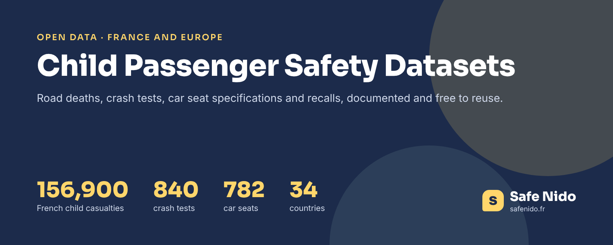

# Child Passenger Safety Datasets

**Free, documented datasets on children in cars, in CSV, checked against their official sources.** Every child aged 0-14 in a French injury road accident since 2005, children killed on the roads of 34 European countries, 840 child car seat crash tests summarised, 782 car seats with their size ranges and rear-facing limits, and 25 car seat recalls.

Each dataset has its own repository with a cover, a data dictionary, a method, its known limits and a citation. The same data is on Kaggle with a starter notebook, on Hugging Face ready for the `datasets` library, and archived on Zenodo with a DOI. They come from the data behind [Safe Nido](https://www.safenido.fr/), an independent French guide to child car seats built on twenty years of crash tests.

## 🚗 Children On The Road

| Dataset | GitHub | Kaggle | Hugging Face | Zenodo |
|---|---|---|---|---|
| 156,900 children aged 0-14 in French injury road accidents, 2005-2025, with seat position, restraint and severity | [france-child-road-casualties](https://github.com/safenido/france-child-road-casualties) | [Kaggle](https://www.kaggle.com/datasets/safenido/france-child-road-casualties-2005-2025) | [Dataset](https://huggingface.co/datasets/safenido/france-child-road-casualties) | [DOI](https://doi.org/10.5281/zenodo.24154143) |
| Children under 15 killed on the roads of 34 European countries, 1999-2024, with rates per million children | [europe-child-road-deaths](https://github.com/safenido/europe-child-road-deaths) | [Kaggle](https://www.kaggle.com/datasets/safenido/child-road-deaths-in-europe-1999-2024) | [Dataset](https://huggingface.co/datasets/safenido/europe-child-road-deaths) | [DOI](https://doi.org/10.5281/zenodo.24154221) |

## 💺 Child Car Seats

| Dataset | GitHub | Kaggle | Hugging Face | Zenodo |
|---|---|---|---|---|
| 840 ADAC and ÖAMTC crash tests summarised by session, seat type, direction, price and brand | [child-car-seat-crash-test-statistics](https://github.com/safenido/child-car-seat-crash-test-statistics) | [Kaggle](https://www.kaggle.com/datasets/safenido/child-car-seat-crash-test-statistics-2007-2026) | [Dataset](https://huggingface.co/datasets/safenido/child-car-seat-crash-test-statistics) | [DOI](https://doi.org/10.5281/zenodo.24154292) |
| 782 seats with height ranges, rear-facing limits, ISOFIX, rotation and Plus Test status | [child-car-seat-specs](https://github.com/safenido/child-car-seat-specs) | [Kaggle](https://www.kaggle.com/datasets/safenido/child-car-seat-specifications-europe) | [Dataset](https://huggingface.co/datasets/safenido/child-car-seat-specs) | [DOI](https://doi.org/10.5281/zenodo.24154408) |
| 25 recalls of child car seats and ISOFIX bases, 2016-2026, with batches and official sources | [child-car-seat-recalls-europe](https://github.com/safenido/child-car-seat-recalls-europe) | [Kaggle](https://www.kaggle.com/datasets/safenido/child-car-seat-recalls-europe-2016-2026) | [Dataset](https://huggingface.co/datasets/safenido/child-car-seat-recalls-europe) | [DOI](https://doi.org/10.5281/zenodo.24154463) |

## 🔬 Inside The ADAC Tests

| Dataset | GitHub | Kaggle | Hugging Face | Zenodo |
|---|---|---|---|---|
| Every ADAC test session since 2007, 39 sessions and 840 seats, with failures and seat types | [adac-child-seat-test-sessions](https://github.com/safenido/adac-child-seat-test-sessions) | [Kaggle](https://www.kaggle.com/datasets/safenido/adac-child-car-seat-test-sessions-2007-2026) | [Dataset](https://huggingface.co/datasets/safenido/adac-child-seat-test-sessions) | [DOI](https://doi.org/10.5281/zenodo.24167071) |
| 23 ADAC criteria, from front impact to installation, averaged by era and seat type | [adac-child-seat-criteria-statistics](https://github.com/safenido/adac-child-seat-criteria-statistics) | [Kaggle](https://www.kaggle.com/datasets/safenido/adac-child-car-seat-test-criteria-statistics) | [Dataset](https://huggingface.co/datasets/safenido/adac-child-seat-criteria-statistics) | [DOI](https://doi.org/10.5281/zenodo.24167196) |
| Harmful substances and PFAS in 725 tested seats since 2011 | [harmful-substances-child-car-seats](https://github.com/safenido/harmful-substances-child-car-seats) | [Kaggle](https://www.kaggle.com/datasets/safenido/harmful-substances-in-child-car-seats-2011-2026) | [Dataset](https://huggingface.co/datasets/safenido/harmful-substances-child-car-seats) | [DOI](https://doi.org/10.5281/zenodo.24167260) |
| The five ADAC test protocols since 2007 and what changed in each | [adac-child-seat-test-protocols](https://github.com/safenido/adac-child-seat-test-protocols) | [Kaggle](https://www.kaggle.com/datasets/safenido/adac-child-car-seat-test-protocols-2007-2026) | [Dataset](https://huggingface.co/datasets/safenido/adac-child-seat-test-protocols) | [DOI](https://doi.org/10.5281/zenodo.24167377) |
| The same seat sold under two brands, and the model that replaced each old seat | [child-car-seat-twins-and-successors](https://github.com/safenido/child-car-seat-twins-and-successors) | [Kaggle](https://www.kaggle.com/datasets/safenido/child-car-seat-twins-and-successors) | [Dataset](https://huggingface.co/datasets/safenido/child-car-seat-twins-and-successors) | [DOI](https://doi.org/10.5281/zenodo.24167315) |

## What The Data Says

- **Unrestrained children are 4.3% of the child car passengers involved in French crashes since 2019, but 21.5% of those killed.**
- **Rear-facing seats score 1.14 on the ADAC front crash, forward-facing seats 2.84** (2020-2024 protocol, lower is better).
- **Children killed on EU roads fell from 1,703 in 2001 to 376 in 2024.** More than half were passengers.
- **236 of 782 car seats sold in Europe have no independent crash test published.**
- **42 seats were rated poor only because of harmful substances in their materials**, while passing the crash part.

## How The Data Is Checked

Each dataset is rebuilt from its source, the French BAAC files of ONISR, Eurostat, the ADAC and ÖAMTC results, manufacturer manuals and RappelConso, then compared with the national figures and with the copy used on Safe Nido. The checks are listed in each README under Checked Against The Source.

## Quick Start

```python
import pandas as pd

base = "https://raw.githubusercontent.com/safenido"
children = pd.read_csv(f"{base}/france-child-road-casualties/main/data/children_in_road_accidents_france_2005_2025.csv.gz", dtype={"department": str})
europe = pd.read_csv(f"{base}/europe-child-road-deaths/main/data/child_road_deaths_europe_1999_2024.csv")
seats = pd.read_csv(f"{base}/child-car-seat-specs/main/data/child_car_seat_specs.csv")
```

## Guides Behind The Data

- [Children still badly strapped in, the figures](https://www.safenido.fr/guides/enfants-mal-attaches-chiffres/)
- [Rear-facing seats and why they are safer](https://www.safenido.fr/guides/siege-auto-dos-a-la-route-plus-sur/)
- [Every ADAC car seat result, explained](https://www.safenido.fr/test-adac/)
- [Car seats with no crash test](https://www.safenido.fr/guides/barometre-sieges-auto-sans-crash-test/) and [car seat recalls](https://www.safenido.fr/guides/rappels-sieges-auto/)

## License

All datasets are CC BY 4.0. Each repository has its own LICENSE and CITATION.cff. Please credit Safe Nido with a link to [safenido.fr](https://www.safenido.fr/) and the original source when you reuse them.

## Version Française

**Des jeux de données ouverts et documentés sur les enfants en voiture, en CSV, vérifiés à la source.** Les enfants impliqués dans les accidents de la route en France depuis 2005, les enfants tués sur les routes de 34 pays européens, 840 crash-tests de sièges auto résumés, 782 sièges auto et leurs caractéristiques, et 25 rappels de sièges. Chaque jeu existe sur GitHub, Kaggle, Hugging Face et Zenodo, sous licence libre, avec les données de [Safe Nido](https://www.safenido.fr/), le guide indépendant des sièges auto.
